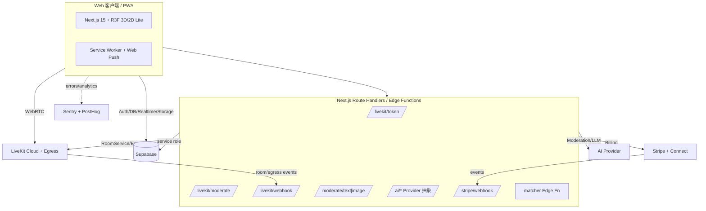

# NEOSOUL — 上线版迭代产品需求文档（PRD v2.0）

> **本文档是给 AI 编码模型（GLM）的实现规格**，在 [PRD.md](./PRD.md)（v1 Demo）的技术底座之上做深度迭代，目标是**一个可以真正上线运营的版本**。
> v1 已定义的技术栈、Supabase schema、LiveKit 麦位流程、目录结构、组件划分**继续沿用**，本文档只写**增量与增强**；凡与 v1 冲突之处以本文档为准。
> 标注约定：`[P0]` = 上线必须（v2.0）；`[P1]` = 上线后首批迭代（v2.1）；`[P2]` = 规划中（v2.2+，先留架构位不实现）。`[决策]` = 已定型不要替换。`[红线]` = 安全/合规/伦理硬约束，绝不可省略或简化。

---

## 0. 给编码模型的执行总则（在 v1 总则之上追加）

1. **先读 v1 PRD**：本项目已有 `PRD.md`，其中的 schema、`/api/livekit/*`、`RoomView`、`PartyScene` 等是地基。本文档新增的表/路由/组件都建立在其上。
2. **分阶段交付**：严格按 §14 里程碑推进。**先把 P0 做成能上线的闭环再碰 P1/P2**。不要一次性铺开所有功能。
3. **安全与合规是上线前置条件**，不是可选项。§10、§13 的 `[红线]` 项在 P0 内必须完成，否则不允许上线。
4. **商业化按 §11 的"公平模型"实现**，明确禁止 §16 反面清单中的任何机制（这是我们与 Soul 的根本区别，写进产品基因，不许"顺手加上"）。
5. **可扩展性优先落架构**：§6.4 房间活动插件系统的接口在 P0 就要定义好（哪怕只实现 1 个活动），后续游戏都走插件，不改核心。
6. **面向全球 Web，不做中国大陆 App 上架**（战略见 §2）。文案/合规按 GDPR/通用隐私法准备，i18n 至少 `zh` + `en`。
7. 每个里程碑结束跑一遍该阶段验收标准 + `pnpm build` + Lighthouse（PWA/性能）自检。

---

## 1. 竞品调研结论（事实 → 洞察）

### 1.1 Clubhouse：语音社交的"教科书级失败"
**能力体系**（我们要吸收的）：
- **舞台模型**：Moderator / Speaker / Audience 三层；听众"举手"→主持人抬上台；可邀请上台、请回听众席、指定他人为主持人；"Leave quietly"（安静离场）。
- **房间类型**：Open（公开）/ Social（关注者）/ Closed（邀请）。
- **Hallway 发现**：基于关注图谱 + 兴趣 + **机器学习排序**（GBDT + 用户/俱乐部 embedding + 实时特征）推荐正在进行的房间。
- **Clubs / Houses**：主题社区，可调度定期房间、House Events（可 RSVP 的日程）。
- **Replays 回放**：录制整场（含上下台动态、pinned links、参会总人数），可下载二次分发。**这是它后期补的关键留存能力。**
- **房内文字/语音双模式**：不打断音频也能发文字；@提醒把人拉进房；Pinned Links（主持人置顶链接，可玩游戏/放投票/带货）。

**为什么衰落**（我们要规避的）：
1. 纯 **FOMO + 邀请制**拉新，**无内容沉淀**（早期禁录）→ 错过即消失，无复访理由。
2. **无审核、无结构**→ 迅速有毒化（仇恨言论），口碑崩塌，名人流失。
3. **无商业化**、不给创作者/房主任何数据与变现→ 创作者无动力。
4. **技术与团队跟不上**规模；功能迭代慢；被 Twitter Spaces 等复制后无护城河。
5. 峰值 400 万→半年跌破百万，2023 裁员过半。

> **洞察**：语音社交要活，必须同时具备【内容沉淀(回放/动态) + 强审核 + 创作者变现 + 快速差异化】。Clubhouse 四样都缺。

### 1.2 Soul：中国"灵魂社交"第一股（我们的正面标靶）
**能力体系**（验证过的强需求，我们要做且做得更好）：
- **虚拟身份**：不看脸、不用真实姓名；注册先做**性格测试（MBTI/三观）**+自选兴趣标签→形成**兴趣图谱**。
- **Avatar 捏脸**：2D 捏脸 → 3D Avatar；"第二自我"。**但 Soul 把绝大多数五官/发型/服饰锁在付费墙后**（单个头像成本可高达数千元，价格带 ¥3.6–5874.9）。
- **群聊派对**（≈我们的房间）：主题式多人语音，文字/开麦皆可，K歌/学习/树洞/闲聊；每月创建/参与超 3.23 亿次"体验"场景。
- **匹配**：灵魂匹配（1v1 文字）、语音匹配、视频匹配、恋爱铃/奇遇铃（附近/随机）。
- **游戏化**：狼人觉醒（已接入 Soul X 让 AI 与真人同场）、幻想星球、Soul 游乐园、音乐房间（K歌房 + 一起听）。
- **AI 层**：自研 Soul X 大模型；灵犀引擎推荐；AI 苟蛋→AI 伴侣（屿你/小桃兔兔）；"帮我回复/帮我改写"降低表达门槛。日均约 460 万用户用过 AI 功能。
- **留存机制**：擦灰（7 天未上线头像蒙灰，好友可擦灰召回）、广场/瞬间动态、Giftmoji 社交电商。
- **数据**：累计注册 3.89 亿；DAU ~1100 万；日均使用 >50 分钟；日启动 20.1 次；3 月留存 80%；30 日新用户留存 23%。Z 世代占 78.7%。

**商业化与其致命问题**（我们要做的反面）：
- 收入 22.1 亿(2024)，毛利 80%+，**90%+ 来自"情绪价值服务"**（虚拟礼物/头像/会员/推荐特权/AI）。
- 但**付费率仅 6.5%**，**充值前 1% 用户贡献 55%**（月充 ¥1608–6096）——**鲸鱼榨取**模型。
- 交互设计处处诱导付费：**强制送礼才能发起对话**、奇遇铃**按年龄明码标价**（匹配 18–25 岁 ¥4.8）、给高人气用户打招呼要买更贵礼物、**礼物收益 100% 归平台**（收礼方不能提现）。
- **AI 伴侣被指诱导消费**（送礼开启语音、超时计费）、被大量用户怀疑"是真人客服"；黑猫投诉 6071 条，出现"数据出错/账号封控诱导充值"、杀猪盘、反催收违规广告。
- 背 **124 亿可赎回负债**（对赌），四度冲 IPO；月活未回到 2021 峰值。
- 匿名主张与"默许主页发真人照片"自相矛盾，本质仍是颜值/条件社交。

> **洞察**：Soul 证明了【虚拟身份 + 兴趣匹配 + 群语音 + 游戏化 + AI 辅助】是真需求、可赚钱；但它的增长已见顶、口碑被**掠夺式商业化**反噬、被合规风险与对赌绑架。**它最脆弱的地方，正是我们的机会**。

### 1.3 一句话战场判断
> 需求被 Soul 验证过（真、且付费），但 Soul 用**重型封闭 App + 掠夺式付费 + 暧昧 AI + 合规高压**把体验做坏了；Clubhouse 证明**没有沉淀/审核/变现**会死。**NEOSOUL 用【轻量 Web + 公平变现 + 透明 AI + 强审核 + 可扩展插件】切进来。**

---

## 2. 战略定位与四大超越点 `[决策]`

**定位**：面向全球 Z 世代的**轻量、开放、健康**的兴趣语音社交平台——"有 Soul 的灵魂，没有 Soul 的套路"。

| # | 超越点 | 具体主张 | 直接打击 Soul/Clubhouse 的哪个痛点 |
|---|---|---|---|
| ① | **轻（Lightweight）** | Web-first + **PWA 安装即用**，跨平台、秒开、免下载免审核；低端设备自动降级到 2D「Lite 模式」 | Soul 重型 native（下载/审核/更新/包大）；Web 天然可分享、SEO 可被发现 |
| ② | **可扩展（Extensible）** | **房间活动插件系统**（游戏/工具/K歌/一起听皆为可插拔模块，有 SDK）；开放 REST/Webhook；AI Provider 可切换；可自部署 | Soul 玩法硬编码封闭；第三方无法接入；扩展靠官方排期 |
| ③ | **公平商业化（Fair）** | **免费即可完整社交**；装扮是可选而非必需；**创作者/房主拿打赏大头**（平台抽成透明且低）；**永不强制送礼、永不 pay-to-DM、永不按年龄标价、无抽卡赌博** | Soul 的强制送礼/鲸鱼榨取/礼物不可提现/消费陷阱（6071 投诉） |
| ④ | **安全透明（Safe & Transparent）** | 强审核（文本/图片/语音举报）、反诈设计、**AI 一律显著标注绝不假装真人**、隐私优先、未成年保护 | Soul 的杀猪盘/暧昧 AI 伴侣/合规高压；Clubhouse 的无审核有毒化 |

**同时保留 Soul 验证过的强项**：虚拟身份 & 自定义 Avatar、兴趣图谱匹配、主题群语音派对、游戏化活动、AI 辅助表达。
**同时吸收 Clubhouse 的正确设计**：舞台礼仪模型、Hallway 发现排序、回放沉淀、房内文字/语音双模式、置顶。

---

## 3. 产品原则（写给所有实现决策做裁决）

1. **免费用户拥有完整社交体验**——付费只买"锦上添花"（装扮/更大房间/更多存储/创作者支持），绝不买"社交的基本权利"。
2. **默认安全**——陌生人交互默认加保护（举报/拉黑/一键静音/离场），未成年与成年分层。
3. **透明胜过留存套路**——AI 必标注；不做擦灰式的情绪绑架；不做"再匹配 N 次强制付费"。
4. **轻优先**——每个功能先问："能不能用 Web 原生能力/已装依赖一行搞定？"（延续 v1 的 ponytail 精神）。3D 是增强，不是门槛。
5. **可扩展优先**——新玩法走插件，不改核心；核心保持小而稳。
6. **创作者友好**——房主/主播能拿到数据、能变现、能带走内容（回放可下载）。

---

## 4. 目标用户与核心场景

- **用户**：18–30 岁为主（含 16–17 未成年分层保护），Z 世代，兴趣驱动、寻找轻社交/陪伴/同好，反感被"割"。
- **核心场景**：
  1. **主题派对**：进入"深夜树洞/学习自习室/K歌房/游戏开黑/读书会"等主题语音房，上麦聊天、公屏发图文、玩房内活动。
  2. **开一场自己的房**：建房→设主题→拉人（分享链接/关注者提醒/ping）→管麦→录制→回放沉淀。
  3. **遇见一个人**：基于兴趣的 1v1 语音/文字匹配，破冰（AI 灵感回复可选），聊得来就互关。
  4. **沉淀与复访**：关注的人开播推送、回放可听、广场看动态——给"错过也能回来"的理由（补 Clubhouse 的洞）。

---

## 5. 功能地图总览

| 模块 | v2.0 `[P0]` 上线必须 | v2.1 `[P1]` | v2.2 `[P2]` |
|---|---|---|---|
| 身份/Avatar | 邮箱+OAuth+匿名登录、兴趣标签、免费 Avatar 捏脸（2D 分层）| 3D Avatar(RPM)、兴趣测试(MBTI)、兴趣图谱向量 | 捏脸师市场、UGC 部件 |
| 房间/舞台 | 舞台模型(主持/共主持/发言/听众)、房间类型(公开/关注/私密)、主题分类、举手上麦、管麦、公屏图文、reactions、置顶、安静离场、3D 场景 + 2D Lite | 日程房/日历、房内文字/语音双模式细化 | House/俱乐部 |
| 房间活动插件 | **插件 SDK + 1 个活动（一起听/Quiz）** | 狼人杀、你画我猜、投票 | 第三方开放插件市场 |
| 发现 | Hallway（正在直播的房，按兴趣+关注启发式排序）、按标签浏览、搜索 | ML 排序、个性化推荐 | 兴趣图谱 embedding 召回 |
| 关系 | 关注、在线状态、Ping 拉人、分享链接 | 好友、私信 | 群组 |
| 回放 | 录制开关 + 回放（LiveKit Egress）| 回放剪辑/下载/精彩片段 | 转文字/检索 |
| 匹配 | — | **遇见**：兴趣 1v1 语音/文字匹配（免费、安全）| 附近的人、群匹配 |
| AI 层 | AI 破冰/帮我回复（显著标注、可关）、AI 文本审核 | AI 匹配、AI 房间共主持、AI 语音审核 | 自研/自选模型 |
| 安全审核 | **举报/拉黑/静音、文本+图片审核、未成年门、ToS/隐私/社区规范、反诈提示、限流** | 审核后台队列、信誉分、申诉流 | 自动化处置模型 |
| 商业化 | **Pro 订阅 + 装扮内购 + 创作者打赏(Stripe/Connect)**（公平模型）| 创作者订阅、房间 Boost | 平台开放分成 |
| 通知/PWA | **PWA 可安装 + Web Push（开播/被 ping）** | 邮件通知、通知中心 | 原生壳(可选) |
| 运维 | Sentry + PostHog + 限流 + LiveKit Webhook 清理 + 健康检查 | 状态页、A/B | 数据仓库 |

---

## 6. 核心功能详规（面向 GLM）

### 6.1 身份、Avatar 与兴趣 `[P0]`
**登录**（在 v1 邮箱+匿名之上追加）：
- 增加 **OAuth**（Google、Apple、Discord 之一起步，用 Supabase Auth Providers）。
- **未成年门 `[红线]`**：注册时收集出生日期（存 `profiles.birth_year` 或 `age_bracket`）。< 18 标记 `is_minor=true`，进入**未成年保护模式**：默认不进陌生人 1v1 匹配、不可被陌生人私信、公屏/上麦有更严审核、不可充值打赏。< 13 直接拒绝（合规）。
- **同意门 `[红线]`**：首次登录必须勾选同意 ToS + 隐私政策 + 社区规范，落库 `profiles.tos_accepted_at`。

**Avatar 捏脸（公平版）`[P0]`**：
- 2D 分层捏脸：底/发型/眼/眉/嘴/服饰/配饰/背景，每层若干选项。**核心部件全部免费**（对标并碾压 Soul 的付费墙）。
- 实现：延续 v1 DiceBear 作为快速底座；捏脸把用户所选各层参数存为 `avatar_config jsonb`（结构化），渲染时合成。若用 DiceBear，其 options 即各层；若做自绘分层，用 SVG 图层叠加。
- 付费只卖**可选皮肤包/限定套装/特效**（§11），不锁基础表达。
- `[P1]` 3D Avatar：接 Ready Player Me，`avatar_glb_url` 存 GLB，房间 3D 场景用 drei `useGLTF` 渲染真人化身替换球体。

**兴趣标签与图谱 `[P0]`**：
- Onboarding 选 3–10 个兴趣标签（预置分类：音乐/游戏/情感/学习/二次元/影视/运动/职场…），存 `profiles.interests text[]`。
- `[P1]` 加轻量 MBTI/性格测试→存 `personality`；`[P2]` 兴趣 embedding（`pgvector`）用于匹配与推荐召回。

**验收**：OAuth 能登录；未成年被正确分层限制；同意门不可跳过；免费能捏出满意头像并全站一致显示。

---

### 6.2 房间与舞台模型 `[P0]` ★核心
在 v1「房主/听众 + 举手上麦」之上，升级为 **Clubhouse 式四层舞台**：

| 角色 | 权限 |
|---|---|
| **Host（房主）** | 全部管麦权；可指定/取消共主持；可结束房间、开关录制、设置置顶、踢人/封禁进入 |
| **Co-host（共主持）** | 管麦（批准/静音/请下麦）、置顶、审核公屏（删消息） |
| **Speaker（发言者）** | 可开麦说话、发公屏、发 reaction |
| **Audience（听众）** | 可听、发公屏文字/图片、reaction、举手申请上麦、安静离场 |

**房间类型**：`open`（任何人可进）/`followers`（房主关注者/互关可进）/`private`（凭邀请链接/邀请码）。存 `rooms.visibility`。
**主题分类**：`rooms.topic`（枚举：闲聊/树洞/学习/K歌/游戏/读书/情感/职场/其它）+ 自由 `tags text[]`，供发现页筛选。
**房间容量**：免费房上限（如 50 人在场，可上麦席位如 12）；Pro 房主可开更大房（见 §11）。存 `rooms.max_participants` / `max_speakers`。

**权限落地**（延续 v1 LiveKit 方案，扩展）：
- Token grant：Host/Co-host/Speaker → `canPublish=true`；Audience → `false`。角色存于 participant metadata `{ role, style, seed, config }`。
- 角色变更走 `/api/livekit/moderate`（§10 扩展 action）：`grant`/`revoke`/`mute`/`kick`/`ban`/`promote_cohost`/`demote_cohost`。**服务端每次校验调用者是 host 或 co-host**（co-host 不能操作 host、不能任命 co-host）。
- **踢人/封禁**：`kick` = `RoomServiceClient.removeParticipant`；`ban` 额外写 `room_bans(room_id, user_id)`，token 签发时若在封禁表则拒绝。
- **安静离场**：客户端直接 `room.disconnect()`，不广播离场提示。

**房间生命周期 `[红线：清理]`**：
- 建房写 `rooms(is_live=true)`。**配置 LiveKit Webhook** → `room_finished`/`participant_left` 事件打到 `/api/livekit/webhook`：房间空或结束时置 `is_live=false`，触发回放落库。避免 v1 里"房间永远挂着"的问题。
- Webhook 必须校验签名（LiveKit 提供）。

**验收**：四角色权限正确且服务端强校验；踢人/封禁生效；房主离开或空房 30s 内自动下播；房间类型准入正确。

---

### 6.3 公屏、互动与房内双模式 `[P0]`
在 v1「公屏文字+图片」之上：
- **Reactions**：轻量表情（👏❤️😂🔥…）飘屏，走 LiveKit data channel（`canPublishData`），**不入库、不收费**（对标 Soul 的付费礼物，我们把基础情绪表达做成免费）。
- **置顶（Pinned）**：房主/共主持可置顶一条消息或一个链接（房间主题、活动入口、创作者的外链），存 `rooms.pinned jsonb`，实时下发。
- **房内文字/语音不冲突**：公屏文字随时可发（不打断音频）；@某人可触发对其的应用内通知/高亮。
- **图片审核 `[红线]`**：见 §10，图片发布前过审。
- **消息治理**：房主/共主持可删任意公屏消息（软删 `messages.deleted_at`）；用户可删自己的。

**验收**：reaction 实时飘屏不入库；置顶实时同步；被删消息即时消失；图片过审后才展示。

---

### 6.4 房间活动插件系统（Room Activity SDK）`[P0 架构 + 1 活动]` ★扩展性核心
这是"更可扩展"的立身之本。**把"玩法"从核心解耦成插件**，新增游戏零核心改动。

**概念**：一个 Activity 是运行在房间内的可插拔模块，含：清单(manifest) + 客户端 UI(Panel) + 权威状态机(reducer) + 状态同步通道。

**接口 `[决策]`**（`lib/activities/types.ts`）：
```ts
export interface ActivityContext {
  roomId: string;
  selfId: string;
  role: 'host' | 'cohost' | 'speaker' | 'audience';
  participants: { id: string; name: string; role: string }[];
  send: (action: ActivityAction) => void;       // 广播动作（reliable data channel）
}
export interface RoomActivity<S = any, A = any> {
  id: string;                       // 'listen-together' | 'quiz' | 'werewolf'
  name: string;
  minPlayers: number;
  maxPlayers: number;
  hostOnlyStart: boolean;
  initialState: (ctx: ActivityContext) => S;
  // 权威 reducer：由 host 客户端执行并广播结果；敏感隐藏信息走服务端（见下）
  reduce: (state: S, action: A, ctx: ActivityContext) => S;
  Panel: React.ComponentType<{ state: S; ctx: ActivityContext }>;  // 房内 UI 覆盖层
  serverAuthoritative?: boolean;    // true 时状态机跑在 Edge Function，隐藏信息不下发
}
```

**状态同步 `[决策]`**：
- 默认 **host 权威**：动作经 LiveKit data channel 广播；host 客户端跑 `reduce`，把新 `state` 广播给全房；后加入者向 host 请求快照。用一张 `activity_sessions(room_id, activity_id, state jsonb, updated_at)` 做持久/兜底快照（Supabase realtime）。
- **需要隐藏信息的游戏**（狼人杀的身份牌）用 `serverAuthoritative=true`：状态机跑在 **Supabase Edge Function**，公共状态下发、私密状态只发给对应玩家。P0 不做这类，先留接口。

**注册与加载**：`lib/activities/registry.ts` 导出 `ACTIVITIES: Record<string, () => Promise<{default: RoomActivity}>>`，用 `next/dynamic` 懒加载；房主在房内「活动」菜单选择启动。

**P0 必做 1 个活动：「一起听」(listen-together)** `[P0]`：
- 房主选一个音频源（先支持**用户上传到 Storage 的音频**或粘贴一个可直链的音频 URL；不集成受版权保护的第三方流媒体，规避版权 `[红线]`）。
- 同步播放：host 广播 `{type:'play', trackUrl, positionMs, atServerTime}`；各端用 `<audio>` 对齐播放位置（简单时间戳对齐即可，非严格采样级同步）。房内语音与音乐可并存（音乐音量可调，避免盖过人声）。
- Panel：播放/暂停/进度 + 当前曲目名 + "谁在听"。
**P1**：Quiz（破冰快问快答）、投票；**P1/P2**：狼人杀（serverAuthoritative 示范）、你画我猜。

**验收**：不改 `RoomView` 核心即可通过 registry 增删活动；「一起听」多端播放位置基本对齐；后加入者能拿到当前活动状态。

---

### 6.5 发现（Hallway）`[P0]`
- **发现页 `/`（登录后首页）**：卡片流展示**正在直播**的公开房，卡片含房名/主题/房主头像/在场人数/上麦人头像预览/标签。
- **排序（P0 启发式）**：`score = w1*关注房主或在场有你关注的人 + w2*兴趣标签重合度 + w3*在场人数(去极端) + w4*新鲜度`。纯 SQL/应用层可算。**留出可替换的 ranking 接口**，`[P1]` 换 ML。
- **在场人数**：DB 无法直接知道 LiveKit 在场数 → 用 LiveKit Webhook（participant_joined/left）维护 `rooms.participant_count`，或定时用 `RoomServiceClient.listParticipants` 同步。P0 用 Webhook 增量维护。
- **筛选/搜索**：按 topic/tag 过滤；按房名搜索（Postgres `ilike` 或全文索引）。
- **空态**：无直播房时引导"开一场"或展示即将开始的日程房（P1）。

**验收**：能看到全站正在进行的公开房并进入；关注/兴趣相关的房排更前；在场人数与实际基本一致。

---

### 6.6 关注、在线与 Ping `[P0]`
- **关注**：`follows(follower_id, followee_id)`；单向关注（对标 Clubhouse/微博）。
- **在线状态**：用 Supabase Realtime Presence 或 LiveKit 在房状态；发现页/个人页显示"某关注对象正在某房"。
- **Ping 拉人**：在房内点关注对象"邀请进房"→应用内通知 + Web Push（§6.12），点击直达房间。
- **分享**：每个房有可分享短链（`/rooms/[id]`，公开房 SEO 友好，带 OG 卡片——Web 的拉新优势）。
- `[P1]` 好友（互关）与私信；私信默认仅互关可发，未成年不可被陌生人私信 `[红线]`。

**验收**：关注生效并影响发现排序；关注对象开播/被 ping 能收到通知并直达。

---

### 6.7 录制与回放（Replays）`[P0]`
补 Clubhouse 早期最大的洞——**内容沉淀 = 复访理由**。
- 房主可在建房/房内开启**录制开关**（默认关；开启时**全房显著提示"本房正在录制" `[红线]`**，知情同意）。
- 实现：**LiveKit Egress**（Room Composite 或 Audio-only Egress）录音频 → 输出到对象存储（Supabase Storage 或 S3 兼容）。Egress 完成 Webhook → 写 `recordings(room_id, url, duration, created_at)`，房间 `is_live=false` 后在房主页/房间页出现"回放"。
- 回放播放页：音频播放器 + 元信息（时长、参与者、置顶记录）。`[P1]` 下载、剪辑精彩片段。
- **隐私 `[红线]`**：仅录制音频与公屏；私密房回放默认仅房主与参与者可见；提供删除回放。

**验收**：开启录制有全房提示；结束后回放可播；关闭录制则无回放；私密房回放受限。

---

### 6.8 遇见 / 匹配（Matching）`[P1]`
Soul 的核心黏性来源，但我们做**免费 + 安全**版：
- **遇见队列**：用户进入"遇见"，选偏好（兴趣/语言，**不做按年龄明码标价 `[红线：反面]`**），进 `match_queue`。
- **配对**：Edge Function / 定时匹配器按兴趣重合度配对（`[P2]` 用 embedding），生成一次性 1v1 LiveKit 房。
- **破冰**：可选 AI 灵感开场白（显著标注 AI，§6.9）。
- **安全 `[红线]`**：一键跳过/举报/拉黑；未成年不进陌生人匹配；反诈提示（见 §10）；无"再匹配需付费"、无强制送礼。
- `[P2]` 恋爱铃式随机、附近的人（需地理位置合规）。

**验收**：能被免费匹配到并语音；跳过/举报即时生效；全程无付费门槛。

---

### 6.9 AI 层（透明版）`[P0 破冰/审核，P1 匹配/共主持]`
对标 Soul 的 AI，但**反其道**：**透明、可关、绝不假装真人 `[红线]`**。
- **AI 破冰 / 帮我回复 `[P0]`**：私信/匹配/评论处提供"帮我想开场白/帮我改写"，调用 LLM（Provider 抽象，见架构），**结果明确标注"AI 生成，仅供参考"**，用户可编辑后自行发送。**默认关闭，用户主动触发**。
- **AI 文本审核 `[P0，红线]`**：见 §10。
- `[P1]` **AI 辅助匹配**：兴趣图谱 + LLM 解释"为什么推荐你们"。
- `[P1]` **AI 房间共主持**：可选的 AI 助手帮房主暖场/引导话题，**头像与名称显著标注 AI**，不得伪装成真人用户。
- **`[红线：绝不做]`**：不做"疑似真人的暧昧 AI 伴侣"、不做"送礼开启 AI 语音/超时计费"、不做诱导充值的情感操纵。这是 Soul 被投诉的核心，我们明确划清。
- **Provider 抽象 `[决策]`**：`lib/ai/provider.ts` 定义统一接口（`complete`, `moderate`），实现可切换（OpenAI / Anthropic / 本地）。密钥仅服务端。

**验收**：AI 产出必带标注；默认不自动代发；无任何伪装真人或诱导付费的 AI。

---

### 6.10 安全、审核、反诈与信任 `[P0 红线]` ★上线前置
**这一节任何一项缺失都不允许上线。**

**用户级工具**：
- **举报**：对用户/房间/消息/回放举报（`reports(reporter_id, target_type, target_id, reason, created_at, status)`）；理由枚举 + 备注。
- **拉黑**：`blocks(blocker_id, blocked_id)`；拉黑后互相不出现在匹配/公屏/私信/同房可选静音。
- **一键静音**：房内静音某人（本地）。
- **未成年保护**：见 §6.1 分层。

**内容审核管线**：
- **文本 `[红线]`**：公屏消息、房名、昵称、瞬间在**入库前**过审——`/api/moderate/text` 调用审核 Provider（OpenAI Moderation 或 LLM 分类器 + 敏感词表）。命中高危→拒绝并提示；命中中危→标记进审核队列。用 Route Handler 或 Edge Function 拦截（不能只靠客户端）。
- **图片 `[红线]`**：上传到 Storage 后、发布前过 NSFW/违规检测（可用一个视觉审核 API 或开源 NSFW 模型）；未过审不生成公屏消息。
- **语音**：实时逐句审核成本高，采用**举报驱动 + 可选录制留证**：被举报的房可由审核后台调取（若开录制）或对重复被举报者限权。
- **审核后台 `[P1]`**：`/admin` 队列（角色 `profiles.role='admin'`），处理 reports，动作：警告/禁言/封房/封号；记录 `moderation_actions`。P0 可先用 Supabase 后台 + 简单管理页处理最高危。

**反诈设计 `[红线]`**（直击 Soul 杀猪盘顽疾）：
- 检测到聊天/公屏出现**外部联系方式、转账、投资、荐股、"加微信/QQ/Telegram"、私下见面**等模式→显示**反诈横幅提示**（"警惕转账/投资/线下诱导"）。
- **平台内无任何转账/借贷功能**；打赏走 Stripe 且不可提现为现金给陌生人（创作者收款是实名 Connect 账户，非 C2C 转账）。
- 首次私信/匹配显示安全提示卡（不轻信、不转账、可举报）。

**限流与滥用防护 `[红线]`**：
- 注册、建房、发消息、上传、匹配、举报均限流（Upstash Redis / Supabase）。防刷号、防轰炸、防批量骚扰。
- 图片上传限制类型与大小；昵称/房名长度与字符校验。

**验收**：违规文本/图片无法发布；举报/拉黑生效；未成年受保护；反诈提示出现在风险场景；关键接口有限流。

---

### 6.11 商业化（公平模型 + Stripe）`[P0]`
**原则**：免费完整社交；付费只买增强与支持创作者；**禁止 §16 的一切掠夺机制**。

**收入线**：
1. **Pro 订阅（Stripe Subscription）**：如 ¥/$ 月费，权益 = 更大房间容量/更多上麦席位、更多回放存储与时长、房间数据分析、专属装扮与徽章、Lite→高清 3D、去除非必要限制。**不含任何"社交基本权利"**。
2. **装扮内购（Stripe one-time）**：可选皮肤包/限定 Avatar 套装/主题/特效。**核心捏脸永久免费**。
3. **创作者打赏/订阅（Stripe Connect）`[决策]`**：观众可给房主/主播打赏或订阅其"频道"；**创作者拿大头（如平台抽成 10–20%，远低于行业），资金进创作者实名 Connect 账户可合规提现**（与 Soul"礼物 100% 归平台、收礼不可提现"形成鲜明对比，作为营销点）。
- 数据表：`subscriptions`、`purchases`、`creator_payouts`、`entitlements`（当前权益）。
- **Webhook `[红线]`**：Stripe Webhook 校验签名后更新 entitlements；幂等处理。
- **合规 `[红线]`**：明码标价、可取消、可退款政策、无自动诱导；未成年不可付费。

**P0 范围**：Pro 订阅 + 至少 1 个装扮内购 + 打赏（Connect 可 P1 上线，但架构 P0 预留）。若时间紧，P0 至少把 Pro 订阅跑通（含 entitlements 影响房间容量）。

**验收**：不付费能完整社交；订阅后权益即时生效；Webhook 幂等且校验签名；未成年被拦截付费；有清晰定价/退款/取消。

---

### 6.12 通知与 PWA `[P0]`
**PWA `[决策，轻量核心卖点]`**：
- `manifest.json`（名称/图标/主题色/`display:standalone`）+ Service Worker（离线壳、静态缓存）。使 NEOSOUL **可"添加到主屏"，安装即用，跨平台**——这就是"比 Soul 更轻"的最直观体现。
- 目标 Lighthouse PWA 通过、性能 ≥ 90（移动端）。首屏轻量，3D 资源按需加载。
- **Lite 模式**：检测低端设备/弱网→用 2D 头像栅格替代 3D 场景（`prefers-reduced-motion` 也走 Lite），保证低端可用。
**Web Push `[P0]`**：
- 关注对象开播、被 @/ping、匹配成功、被批准上麦 → Web Push（VAPID）。用户可在设置里开关各类通知 `[红线：默认克制，不轰炸]`。

**验收**：可安装到主屏并独立窗口打开；离线有基本壳；关键事件收到推送；低端设备走 Lite 不卡死。

---

## 7. 数据模型 v2（增量 SQL）
> 在 v1 `schema.sql` 基础上新增/修改。GLM 存为 `supabase/schema_v2.sql`，含必要的 RLS。

```sql
-- profiles 增列
alter table public.profiles
  add column if not exists avatar_config jsonb,          -- 分层捏脸参数
  add column if not exists avatar_glb_url text,           -- [P1] 3D
  add column if not exists interests text[] default '{}',
  add column if not exists personality text,              -- [P1] MBTI 等
  add column if not exists birth_year int,                -- 未成年门
  add column if not exists is_minor boolean default false,
  add column if not exists role text default 'user' check (role in ('user','admin')),
  add column if not exists tos_accepted_at timestamptz;

-- rooms 增列
alter table public.rooms
  add column if not exists visibility text default 'open' check (visibility in ('open','followers','private')),
  add column if not exists topic text default 'chat',
  add column if not exists tags text[] default '{}',
  add column if not exists max_participants int default 50,
  add column if not exists max_speakers int default 12,
  add column if not exists recording_enabled boolean default false,
  add column if not exists participant_count int default 0,
  add column if not exists pinned jsonb,
  add column if not exists invite_code text unique;        -- private 房邀请码

create table if not exists public.follows (
  follower_id uuid references public.profiles(id) on delete cascade,
  followee_id uuid references public.profiles(id) on delete cascade,
  created_at timestamptz default now(),
  primary key (follower_id, followee_id)
);

create table if not exists public.room_roles (        -- 持久化 cohost 任命（token 之外的兜底）
  room_id uuid references public.rooms(id) on delete cascade,
  user_id uuid references public.profiles(id) on delete cascade,
  role text not null check (role in ('cohost')),
  primary key (room_id, user_id)
);

create table if not exists public.room_bans (
  room_id uuid references public.rooms(id) on delete cascade,
  user_id uuid references public.profiles(id) on delete cascade,
  primary key (room_id, user_id)
);

create table if not exists public.recordings (
  id bigint generated always as identity primary key,
  room_id uuid references public.rooms(id) on delete cascade,
  url text not null, duration int, created_at timestamptz default now()
);

create table if not exists public.activity_sessions (
  room_id uuid references public.rooms(id) on delete cascade,
  activity_id text not null,
  state jsonb, updated_at timestamptz default now(),
  primary key (room_id)
);

create table if not exists public.blocks (
  blocker_id uuid references public.profiles(id) on delete cascade,
  blocked_id uuid references public.profiles(id) on delete cascade,
  created_at timestamptz default now(),
  primary key (blocker_id, blocked_id)
);

create table if not exists public.reports (
  id bigint generated always as identity primary key,
  reporter_id uuid references public.profiles(id) on delete set null,
  target_type text not null check (target_type in ('user','room','message','recording')),
  target_id text not null, reason text not null, note text,
  status text default 'open' check (status in ('open','reviewing','actioned','dismissed')),
  created_at timestamptz default now()
);

create table if not exists public.moderation_actions (
  id bigint generated always as identity primary key,
  admin_id uuid references public.profiles(id),
  target_type text, target_id text, action text, note text,
  created_at timestamptz default now()
);

create table if not exists public.match_queue (       -- [P1]
  user_id uuid primary key references public.profiles(id) on delete cascade,
  prefs jsonb, enqueued_at timestamptz default now()
);

-- 商业化
create table if not exists public.entitlements (
  user_id uuid primary key references public.profiles(id) on delete cascade,
  is_pro boolean default false, pro_until timestamptz,
  cosmetics text[] default '{}'
);
create table if not exists public.subscriptions (
  id text primary key,                                  -- stripe subscription id
  user_id uuid references public.profiles(id) on delete cascade,
  status text, current_period_end timestamptz, created_at timestamptz default now()
);
create table if not exists public.purchases (
  id text primary key,                                  -- stripe payment intent id
  user_id uuid references public.profiles(id) on delete cascade,
  sku text, amount int, currency text, created_at timestamptz default now()
);
create table if not exists public.creator_payouts (    -- Stripe Connect
  id bigint generated always as identity primary key,
  creator_id uuid references public.profiles(id) on delete cascade,
  from_user_id uuid, amount int, currency text, kind text, created_at timestamptz default now()
);

-- RLS：所有新表启用 RLS。要点：
--  follows/blocks：本人可增删自己的行；可读与自己相关的。
--  reports：任何登录用户可 insert（举报）；仅 admin 可 select/update。
--  room_roles/room_bans：仅房主可写（服务端用 service role 代理更稳妥）；房内可读。
--  entitlements/subscriptions/purchases：仅本人可读；写入仅服务端 service role（Stripe webhook）。
--  moderation_actions：仅 admin 可读写。
-- （逐表 policy 由 GLM 按此原则补全，参照 v1 风格。）
alter publication supabase_realtime add table public.activity_sessions;
```

---

## 8. 系统架构 v2



**关键新增**：LiveKit **Egress**（录制）、LiveKit **Webhook**（房间/录制生命周期）、**审核 Provider**、**AI Provider 抽象**、**Stripe(+Connect)**、**Edge Function 匹配器**、**Sentry/PostHog**、**限流(Upstash/Redis)**。

---

## 9. 目录结构 v2（增量）
```
Neosoul/
├─ app/
│  ├─ (marketing)/               # 落地页/定价/ToS/隐私/社区规范（SEO+合规）
│  │  ├─ page.tsx  pricing/  legal/terms/  legal/privacy/  legal/guidelines/
│  ├─ discover/page.tsx          # Hallway 发现（登录后首页）
│  ├─ meet/page.tsx              # [P1] 遇见/匹配
│  ├─ u/[handle]/page.tsx        # 个人主页（关注/回放/装扮）
│  ├─ rooms/[id]/replay/page.tsx # 回放播放
│  ├─ admin/page.tsx             # [P1] 审核后台
│  ├─ settings/                  # 账户/通知/隐私/订阅
│  └─ api/
│     ├─ livekit/{token,moderate,webhook}/route.ts
│     ├─ moderate/{text,image}/route.ts
│     ├─ ai/{icebreaker,assist}/route.ts
│     ├─ stripe/{checkout,webhook,connect}/route.ts
│     └─ push/subscribe/route.ts
├─ components/
│  ├─ room/  (RoomView, PartyScene, AvatarOrb, LiteGrid, ChatPanel,
│  │          Stage, MicControls, HostPanel, Reactions, PinnedBar, ActivityHost)
│  ├─ activities/ (listen-together/, quiz/ …)     # 插件 UI
│  ├─ avatar/ (AvatarPicker2D, AvatarRender)
│  ├─ discovery/ (RoomCard, Filters)
│  └─ safety/ (ReportDialog, BlockButton, AntiFraudBanner, ConsentGate)
├─ lib/
│  ├─ activities/ (types.ts, registry.ts)
│  ├─ ai/provider.ts
│  ├─ moderation.ts
│  ├─ ranking.ts                 # Hallway 排序（可替换）
│  ├─ ratelimit.ts
│  ├─ stripe.ts  entitlements.ts
│  └─ push.ts
├─ supabase/{schema.sql, schema_v2.sql, functions/matcher/}
├─ public/{manifest.json, sw.js, icons/}
├─ messages/{zh.json, en.json}   # i18n (next-intl)
└─ README.md
```

---

## 10. API 契约 v2（新增/扩展要点）
> 通用：均先 `getUser()`；写操作限流；涉及房主/共主持/admin 的操作**服务端强校验角色**。

- `POST /api/livekit/moderate`（扩展）：`action ∈ {grant,revoke,mute,kick,ban,promote_cohost,demote_cohost}`；校验 caller 为 host（cohost 仅限 grant/revoke/mute/删消息，不能操作 host、不能任命 cohost）。`ban` 写 `room_bans`；`kick` = removeParticipant。
- `POST /api/livekit/token`（扩展）：签发前查 `room_bans`（命中拒绝）、查 `room_roles`（cohost 给 publish）、按 `entitlements` 决定可建/进的房容量；metadata 带 `{role,style,seed,config}`。
- `POST /api/livekit/webhook`：校验 LiveKit 签名；处理 `room_started/finished`、`participant_joined/left`（维护 `participant_count`、空房置 `is_live=false`）、`egress_ended`（写 `recordings`）。
- `POST /api/moderate/text`：入参文本 → `{ allowed, severity, categories }`；公屏/房名/昵称发布前调用。
- `POST /api/moderate/image`：入参 storage path → 过审 → `{ allowed }`。
- `POST /api/ai/icebreaker` / `assist`：LLM 生成，返回**带 AI 标注**的建议文本；限流；默认不自动发送。
- `POST /api/stripe/checkout`：创建订阅/内购 Checkout Session。
- `POST /api/stripe/webhook`：校验签名、幂等；更新 `subscriptions/purchases/entitlements`。
- `POST /api/push/subscribe`：保存 Web Push 订阅。
- Edge Function `matcher`：定时/触发配对 `match_queue` → 建 1v1 房 → 通知双方。 `[P1]`

---

## 11. 非功能需求
- **性能**：移动端 Lighthouse 性能 ≥ 90、PWA 通过；首屏 JS 精简，3D/活动代码分包懒加载；LiveKit 音频优先，3D 掉帧自动降级 Lite。
- **可用性**：房间连接失败有重试；弱网降级；LiveKit/Supabase 故障有友好降级与提示（延续 v1 §16 并扩展）。
- **可访问性 `[红线基线]`**：键盘可达、focus 可见、对比度达标、图片 alt、动效尊重 `prefers-reduced-motion`、屏幕阅读器可读关键控件。
- **i18n**：`next-intl`，`zh`+`en`；文案不硬编码。
- **隐私**：最小化收集；不把个人数据放 URL；敏感数据加密存储；可导出与删除账号数据（§13）。

---

## 12. 可观测性与运维
- **Sentry**（前后端错误）、**PostHog**（漏斗/留存/事件，尊重同意与隐私）、结构化日志。
- **健康检查**：`/api/health` 探 Supabase/LiveKit/Stripe 可达性。
- **LiveKit Egress 存储**与清理策略（回放保留期、Pro 更长）。
- **限流后端**：Upstash Redis（或 Supabase）。
- **备份**：Supabase 自动备份开启；关键表迁移用版本化 SQL。

---

## 13. 合规与法务 `[P0 红线]`
- **法律页**：ToS、隐私政策、社区规范、Cookie/同意（`app/(marketing)/legal/*`）。上线前必须有真实内容（可用标准模板起草，创始人审阅）。
- **年龄分层**：< 13 拒绝；13–17 未成年保护模式；成年验证以出生日期声明为准（P0），`[P1]` 视地区加强验证。
- **数据主体权利**：账号数据导出与**彻底删除**（级联删除 profiles 及关联；回放/消息按政策处理）。删除是用户发起、二次确认的自助流程（**Claude/GLM 不代删他人数据**）。
- **录制知情同意**：录制房全程显著提示（§6.7）。
- **支付合规**：明码标价、退款与取消政策、未成年禁付、Connect 创作者 KYC 由 Stripe 承担。
- **内容合规**：审核管线（§10）；违规响应与申诉（`[P1]` 申诉流）。
- **战略性规避**：面向全球 Web 发行，**不做中国大陆应用商店上架**，以规避国内社交软件的 ICP/网络文化经营许可/实名等重合规负担（这也是"比 Soul 更轻、更快上线"的现实基础）。若日后进入特定市场，再按当地法规单独评估。

---

## 14. 分阶段路线图与里程碑（给 GLM）
> **原则：先把一个"安全、可付费、能沉淀"的核心闭环做成能上线，再加匹配/游戏/后台。**

**M0 — 迁移与地基**（在 v1 之上）
- 跑通 v1（M1–M6）；接入 i18n、PWA 壳、Sentry/PostHog、限流；补 `schema_v2.sql`。

**M1 — 舞台与房间升级 `[P0]`**
- 四角色舞台、房间类型/主题/容量、cohost、踢人/封禁、置顶、reactions、安静离场、LiveKit Webhook 生命周期清理。

**M2 — 安全与合规底座 `[P0 红线]`**
- 举报/拉黑/静音、文本+图片审核管线、未成年门与同意门、反诈提示、限流、法律页。**这是上线闸门。**

**M3 — 发现与关系 `[P0]`**
- Hallway 发现（启发式排序 + 在场人数）、搜索/筛选、关注、在线状态、Ping、分享短链 + OG 卡。

**M4 — 沉淀与商业化 `[P0]`**
- 录制/回放（Egress）、个人主页；Stripe Pro 订阅 + 装扮内购 + entitlements 影响容量；（打赏 Connect 架构预留/可 P1）。

**M5 — 扩展性与活动 `[P0 架构 + 1 活动]`**
- 房间活动插件 SDK + registry + ActivityHost；实现「一起听」；接入 Web Push（开播/ping/上麦）。

**M6 — 上线硬化 `[P0]`**
- 端到端安全回归、性能/PWA/可访问性达标、错误与降级、部署（Vercel + Supabase + LiveKit + Stripe 生产 key）、状态与监控、README/Runbook。**过 §15 验收后上线。**

**v2.1 `[P1]`**：遇见/匹配、审核后台队列、AI 匹配/共主持、狼人杀等更多活动、日程房、好友/私信、创作者订阅。
**v2.2 `[P2]`**：3D Avatar、兴趣 embedding 召回、开放插件市场、House/俱乐部、捏脸师市场。

---

## 15. 上线验收 Checklist（Definition of Done for launch）
**功能**
- [ ] 四角色舞台权限正确且服务端强校验；踢/封/静音/置顶生效
- [ ] 公屏图文实时；reactions 免费飘屏；违规文本/图片无法发布
- [ ] Hallway 能发现正在进行的公开房并进入；排序合理；在场人数准确
- [ ] 关注/Ping/分享短链可用；关键事件 Web Push 到达
- [ ] 录制房有显著提示；回放可播且权限正确
- [ ] 活动插件 SDK 可增删活动；「一起听」多端对齐
- [ ] PWA 可安装；低端设备走 2D Lite 不卡死

**安全/合规 `[红线，缺一不可上线]`**
- [ ] 举报/拉黑/未成年保护/同意门/反诈提示/限流全部就位
- [ ] 文本+图片审核在发布前拦截高危内容
- [ ] ToS/隐私/社区规范上线且可访问；账号数据可删除
- [ ] 服务端密钥不进客户端；房主/admin 操作服务端校验；Stripe/LiveKit Webhook 校验签名且幂等

**商业化 `[红线]`**
- [ ] 免费可完整社交；付费仅增强；未成年禁付
- [ ] **无强制送礼、无 pay-to-DM、无按年龄标价、无抽卡赌博**（§16 全部为否）
- [ ] 定价/退款/取消清晰；entitlements 即时生效

**质量**
- [ ] 移动端 Lighthouse 性能≥90 & PWA 通过；可访问性基线达标；Sentry 无高频未处理错误

---

## 16. 反面清单——我们**绝不做**的（写进产品基因）`[红线]`
> 这些是 Soul 被投诉/被反噬的机制，是 NEOSOUL 的差异化护城河，任何人（含未来的自己）提议加入都应被本清单否决。

1. ❌ 强制送礼才能发起对话 / 打招呼要付费。
2. ❌ 按对方年龄/性别**明码标价**匹配（如"匹配 18–25 岁 ¥4.8"）。
3. ❌ 对高人气用户**自动抬高**收礼/搭讪门槛。
4. ❌ 礼物/收益**不可提现且 100% 归平台**的 C2C 诱导；不做平台内转账/借贷。
5. ❌ 抽卡/盲盒/赌博式付费机制。
6. ❌ "再匹配 N 次需付费""数据出错/账号封控"等诱导充值话术。
7. ❌ 伪装成真人的暧昧 AI 伴侣、送礼开启 AI 语音、超时计费的情感操纵。
8. ❌ 把"社交的基本权利"（发消息、上麦、被匹配）放进付费墙。
9. ❌ 无审核放任有毒内容（Clubhouse 之鉴）。
10. ❌ 无内容沉淀的纯 FOMO 增长（Clubhouse 之鉴）。

---

## 17. 附录：NEOSOUL vs Soul 逐项对照
| 维度 | Soul | NEOSOUL |
|---|---|---|
| 载体 | 重型 native App（下载/审核/更新）| **Web + PWA 安装即用，跨平台秒开** |
| Avatar | 捏脸核心多锁付费墙（单个可上千元）| **核心捏脸永久免费**，付费仅可选皮肤 |
| 群语音 | 群聊派对（封闭玩法）| 舞台模型 + **可扩展活动插件 SDK** |
| 变现 | 强制送礼/鲸鱼榨取/礼物不可提现/9 成情绪价值 | **公平 freemium + 创作者可提现打赏**，抽成低透明 |
| AI | 暧昧 AI 伴侣（疑似真人/诱导付费）| **透明标注、可关、绝不假装真人**、辅助表达 |
| 内容沉淀 | 广场/瞬间 | 回放(Replays) + 主页 + 分享短链(SEO) |
| 匹配 | 按条件明码标价 | **免费、安全、反诈**的兴趣匹配 `[P1]` |
| 合规 | 国内高压 + 6071 投诉 + 杀猪盘 | 全球 Web 发行 + 强审核 + 反诈设计 |
| 扩展性 | 官方排期硬编码 | **插件/开放 API/可自部署** |

---

### 给 GLM 的最后提醒
- **上线闸门是 M2（安全合规）**，不是功能多寡；`[红线]` 项没做完就不算"可上线"。
- **商业化按公平模型 + §16 反面清单实现**——这是产品灵魂，不是可选风格。
- **扩展性在 P0 就把 SDK 接口定死**，后续所有玩法走插件；核心保持小而稳。
- 复用 v1 的一切；本文档是"增量"。不确定的库用法以官方文档为准，不要臆造 API。
- 竞品数据（Soul 招股书等）见 §1，用于校准判断，不必写进代码。
