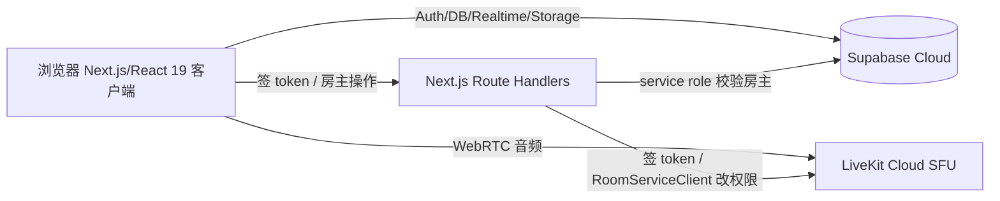
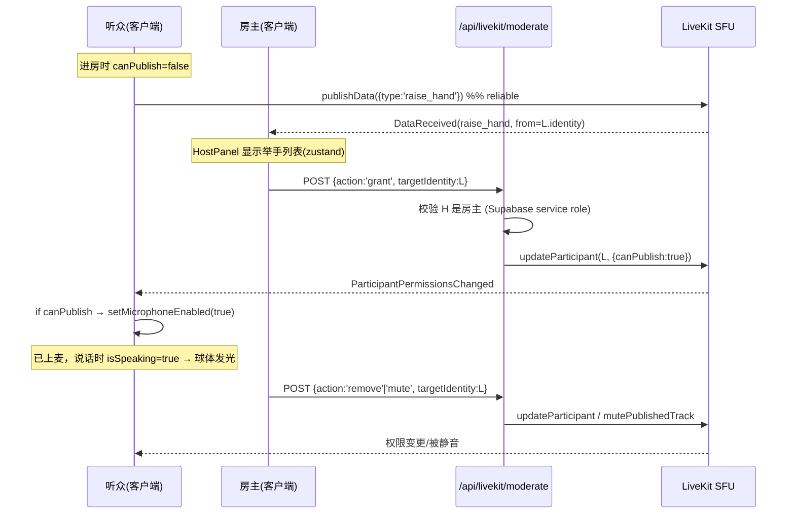

# Neosoul — 极简语音派对 App · 产品需求文档（PRD v1.0）

> 本文档是**给 AI 编码模型（GLM）的实现规格**。目标：按此文档从零构建一个可运行的 Web 语音派对 Demo。
> 文档要求精确、无歧义。凡是给出的字段名、路由、SQL、env key、函数签名，**必须严格照用**，不要自行改名。
> 凡标注 `[决策]` 的是已定型的技术选择，不要替换；标注 `[可选/v0.2]` 的是明确不做、留给后续版本的。

---

## 0. 给编码模型的执行总则

1. **技术栈固定**：见 §3，版本按 `package.json` 清单安装，不要引入未列出的重型依赖。
2. **零自建后端**：所有后端能力来自 Supabase（账号/数据库/存储/实时）与 LiveKit（语音）。只写 Next.js Route Handler 作为签发 token 和鉴权代理，不写独立 server。
3. **实现顺序按 §18 的里程碑走**，每个里程碑结束时对照该里程碑的验收标准自检。
4. **权限校验不可省**：所有涉及"房主操作"的 API 必须在服务端用 service role 校验调用者确实是房主（§9、§17），不能只靠前端隐藏按钮。
5. **密钥只在服务端使用**：`SUPABASE_SERVICE_ROLE_KEY`、`LIVEKIT_API_SECRET` 绝不出现在任何 `NEXT_PUBLIC_*` 或客户端 bundle 中。
6. **代码风格**：TypeScript strict、函数式、小文件（单文件 < 300 行），组件用 `PascalCase`，工具函数 `camelCase`。
7. 完成后 `README.md` 写清楚：需要开通的外部服务、需要填的 env、`pnpm dev` 启动步骤。

---

## 1. 产品概述

Neosoul 是一个 Web 端极简语音派对应用。用户注册/匿名登录后选一个自定义头像，进入房间列表，建房或加入房间。房间是一个 **3D 派对空间**：每个在场用户是一个会随说话发光/跳动的球体。用户默认是"听众"，通过"举手 → 房主批准"上麦语音发言；房主可管理麦位（批准/静音/请下麦）。所有人可在**公屏**发文字和图片，实时同步。

**一句话**：注册 → 选头像 → 建房/进房 → 3D 派对里上麦聊天 → 房主管麦 → 公屏发图文。

---

## 2. 目标与非目标

### 2.1 Demo 成功标准（必须全部达成）
- 两台不同设备/浏览器能进同一房间并**互相听到语音**。
- 3D 场景中每个参与者是一个球体，**正在说话者的球体实时发光放大**。
- 听众点"举手" → 房主端出现该请求 → 房主"批准" → 该用户**立即获得麦克风权限并可发声**。
- 房主能对某个麦上用户执行**静音 / 请下麦**。
- 公屏能发**文字**和**图片**，房间内所有人**实时**看到。
- 全流程跑在 Supabase / LiveKit / Vercel 免费额度上，无需自建服务器。

### 2.2 非目标（本版本明确不做）
好友/关注/私信/匹配/灵魂测试、礼物金币等级商城、视频/屏幕共享/背景伴奏、房间密码与搜索推荐、消息撤回/@/举报、可自由移动的 3D 化身、空间音频。全部 `[可选/v0.2]`。

---

## 3. 技术栈与版本 `[决策]`

| 层 | 选型 | 说明 |
|---|---|---|
| 语言 | TypeScript 5.x（strict） | 全项目 |
| 框架 | Next.js 15（App Router）+ React 19 | 一体化前后端 |
| 包管理 | pnpm | |
| 语音 | LiveKit（`livekit-client` v2、`livekit-server-sdk` v2、`@livekit/components-react` v2） | WebRTC SFU；服务端动态改发言权限 |
| 账号/DB/存储/实时 | Supabase（`@supabase/supabase-js` v2、`@supabase/ssr`） | Auth + Postgres + Storage + Realtime |
| 3D | `three` + `@react-three/fiber` v9 + `@react-three/drei` v9/10 | R3F v9 需 React 19，与本栈匹配 |
| 头像 | `@dicebear/core` v9 + `@dicebear/collection` v9 | 种子生成头像；`[可选/v0.2]` 升级 Ready Player Me 3D 化身 |
| UI | Tailwind CSS + shadcn/ui（按需） | 极简 |
| 客户端状态 | `zustand` v5 | 轻量 |
| 部署 | Vercel（前端）+ Supabase Cloud + LiveKit Cloud | 三个免费托管 |

### 3.1 `package.json` 依赖清单（据此安装，版本可取各包当前 stable）
```jsonc
{
  "dependencies": {
    "next": "^15",
    "react": "^19",
    "react-dom": "^19",
    "@supabase/supabase-js": "^2",
    "@supabase/ssr": "^0.5",
    "livekit-client": "^2",
    "livekit-server-sdk": "^2",
    "@livekit/components-react": "^2",
    "@livekit/components-styles": "^1",
    "three": "^0.169",
    "@react-three/fiber": "^9",
    "@react-three/drei": "^9",
    "@dicebear/core": "^9",
    "@dicebear/collection": "^9",
    "zustand": "^5",
    "clsx": "^2"
  },
  "devDependencies": {
    "typescript": "^5",
    "@types/react": "^19",
    "@types/node": "^22",
    "@types/three": "^0.169",
    "tailwindcss": "^3.4",
    "postcss": "^8",
    "autoprefixer": "^10"
  }
}
```
> 兼容性要点：`@react-three/fiber@9` 必须配 React 19；`livekit-server-sdk@2` 的 `AccessToken.toJwt()` 返回 **Promise**（要 `await`）。

---

## 4. 系统架构



- **客户端**直接连 Supabase（RLS 保护）和 LiveKit（凭 token）。
- **Route Handler** 只做两件事：① 签发 LiveKit token（决定初始发言权限）；② 房主管麦操作（服务端校验房主身份后调用 LiveKit `RoomServiceClient`）。
- 麦位/发言状态**不落 DB**，由 LiveKit 的 participant permission + metadata 承载。房间/用户/消息落 Supabase。

---

## 5. 外部服务准备与环境变量

### 5.1 需要人工开通的服务（写进 README）
1. **Supabase 项目**：创建项目 → 在 Auth → Providers 中**启用 Email** 与 **Anonymous sign-ins** → 建两个 Storage bucket：`avatars`（public）、`chat-images`（public）→ 在 SQL Editor 执行 §6 的 `schema.sql`。
2. **LiveKit Cloud 项目**：创建项目，拿到 `wss://<xxx>.livekit.cloud`、API Key、API Secret。

### 5.2 `.env.example`（GLM 需在项目根创建此文件）
```bash
# Supabase
NEXT_PUBLIC_SUPABASE_URL=https://xxxx.supabase.co
NEXT_PUBLIC_SUPABASE_ANON_KEY=eyJ...
SUPABASE_SERVICE_ROLE_KEY=eyJ...          # 仅服务端使用

# LiveKit
NEXT_PUBLIC_LIVEKIT_URL=wss://xxxx.livekit.cloud   # 客户端连接用（wss）
LIVEKIT_API_KEY=APIxxxx
LIVEKIT_API_SECRET=xxxx                    # 仅服务端使用
```
> `RoomServiceClient` 需要 **https** host：在服务端用 `NEXT_PUBLIC_LIVEKIT_URL.replace('wss://','https://')` 转换。这是常见坑，务必处理。

---

## 6. 数据模型（Supabase Postgres）— `supabase/schema.sql`

> 完整可执行 SQL。GLM 将其存为 `supabase/schema.sql` 并在文档说明中让用户在 Supabase SQL Editor 运行。

```sql
-- ========== profiles：用户资料（1:1 于 auth.users）==========
create table if not exists public.profiles (
  id            uuid primary key references auth.users(id) on delete cascade,
  display_name  text not null default 'Guest',
  avatar_style  text not null default 'thumbs',   -- DiceBear 风格名
  avatar_seed   text not null default 'neo',       -- DiceBear 种子
  created_at    timestamptz not null default now()
);

-- 新用户注册时自动建 profile（含匿名用户）
create or replace function public.handle_new_user()
returns trigger language plpgsql security definer set search_path = public as $$
begin
  insert into public.profiles (id, display_name)
  values (new.id, coalesce(new.raw_user_meta_data->>'display_name', 'Guest'))
  on conflict (id) do nothing;
  return new;
end; $$;

drop trigger if exists on_auth_user_created on auth.users;
create trigger on_auth_user_created
  after insert on auth.users
  for each row execute function public.handle_new_user();

-- ========== rooms：房间 ==========
create table if not exists public.rooms (
  id            uuid primary key default gen_random_uuid(),
  name          text not null,
  host_id       uuid not null references public.profiles(id) on delete cascade,
  livekit_room  text not null unique,     -- 例：'room_<id>'
  is_live       boolean not null default true,
  created_at    timestamptz not null default now()
);
create index if not exists rooms_is_live_idx on public.rooms(is_live, created_at desc);

-- ========== messages：公屏消息 ==========
create table if not exists public.messages (
  id         bigint generated always as identity primary key,
  room_id    uuid not null references public.rooms(id) on delete cascade,
  sender_id  uuid not null references public.profiles(id) on delete cascade,
  kind       text not null check (kind in ('text','image')),
  body       text not null,              -- text 内容 或 image 的 public URL
  created_at timestamptz not null default now()
);
create index if not exists messages_room_idx on public.messages(room_id, created_at);

-- ========== RLS ==========
alter table public.profiles enable row level security;
alter table public.rooms    enable row level security;
alter table public.messages enable row level security;

-- profiles：所有登录用户可读；只能改自己的
create policy "profiles_read"   on public.profiles for select to authenticated using (true);
create policy "profiles_update" on public.profiles for update to authenticated using (auth.uid() = id) with check (auth.uid() = id);

-- rooms：所有登录用户可读；只能以自己为 host 建房；只能改/删自己建的房
create policy "rooms_read"   on public.rooms for select to authenticated using (true);
create policy "rooms_insert" on public.rooms for insert to authenticated with check (auth.uid() = host_id);
create policy "rooms_update" on public.rooms for update to authenticated using (auth.uid() = host_id);
create policy "rooms_delete" on public.rooms for delete to authenticated using (auth.uid() = host_id);

-- messages：所有登录用户可读；只能以自己为 sender 发消息
create policy "messages_read"   on public.messages for select to authenticated using (true);
create policy "messages_insert" on public.messages for insert to authenticated with check (auth.uid() = sender_id);

-- ========== Realtime：把 messages 加入 realtime publication ==========
alter publication supabase_realtime add table public.messages;
```

> **Storage 策略**（在 Supabase Storage 面板或 SQL 配置）：`avatars`、`chat-images` 两个 bucket 设为 public 读；写入策略限制为 `authenticated` 角色。

---

## 7. 目录结构（GLM 严格照建）

```
Neosoul/
├─ app/
│  ├─ layout.tsx                     # 根布局，全局样式
│  ├─ globals.css                    # Tailwind + livekit styles import
│  ├─ page.tsx                       # 落地：已登录→/rooms，未登录→/login
│  ├─ login/page.tsx                 # 登录/注册/匿名
│  ├─ onboarding/page.tsx            # 昵称 + 头像选择
│  ├─ rooms/
│  │  ├─ page.tsx                    # 房间列表 + 建房
│  │  └─ [id]/page.tsx               # 房间页（核心）
│  ├─ auth/callback/route.ts         # Supabase auth 回调（email 确认用）
│  └─ api/
│     └─ livekit/
│        ├─ token/route.ts           # POST 签发 token
│        └─ moderate/route.ts        # POST 房主管麦（grant/mute/remove）
├─ components/
│  ├─ AvatarPicker.tsx               # DiceBear 头像选择
│  ├─ AvatarImage.tsx                # 由 style+seed 渲染 
│  ├─ RoomView.tsx                   # 房间主容器（含 LiveKitRoom provider）
│  ├─ PartyScene.tsx                 # R3F Canvas 3D 派对
│  ├─ AvatarOrb.tsx                  # 单个球体（音频驱动）
│  ├─ ChatPanel.tsx                  # 公屏文字+图片
│  ├─ MicControls.tsx               # 底部麦克风/举手/下麦
│  └─ HostPanel.tsx                  # 房主：举手列表 + 管麦
├─ lib/
│  ├─ supabase/client.ts             # 浏览器端 client（@supabase/ssr）
│  ├─ supabase/server.ts             # 服务端 client（cookies）
│  ├─ supabase/admin.ts              # service role client（仅服务端）
│  ├─ livekit-server.ts              # token 签发 + RoomServiceClient 封装
│  ├─ avatar.ts                      # DiceBear dataUri 生成 + 风格列表
│  └─ store.ts                       # zustand（举手列表、UI 状态）
├─ supabase/schema.sql
├─ middleware.ts                     # Supabase session 刷新
├─ .env.example
├─ package.json
├─ tailwind.config.ts
├─ tsconfig.json
└─ README.md
```

---

## 8. 页面与路由规格

> 通用：未登录访问 `/rooms`、`/rooms/[id]`、`/onboarding` 一律重定向到 `/login`。已登录但 profile 未完成头像选择（可用一个标记：例如 `display_name === 'Guest'` 视为未 onboard，或加个 `onboarded` 布尔——本 Demo 用"进过 onboarding 页保存过一次"即算完成，简单起见 landing 判断 profile 是否存在且 display_name 非默认）。

### 8.1 `/login` — 登录/注册/匿名
- **布局**：居中卡片，产品名 "Neosoul"，一句 slogan。
- **表单**：Email + Password；两个主按钮「登录」「注册」；下方一个次按钮「先随便逛逛（匿名进入）」。
- **交互**：
  - 注册：`supabase.auth.signUp({ email, password })`。若项目开启邮箱确认，提示"查收邮件"；Demo 建议在 Supabase 关闭邮箱确认以便直接登录。
  - 登录：`signInWithPassword`。
  - 匿名：`supabase.auth.signInAnonymously()`（需在 Supabase 启用）。
  - 成功后：若已 onboard → `/rooms`，否则 → `/onboarding`。
- **验收**：三种方式都能拿到 session 并跳转。

### 8.2 `/onboarding` — 昵称 + 头像选择
- **布局**：顶部大号头像预览；下方昵称输入框；再下方头像风格切换（DiceBear 若干风格 tab）+「🎲 随机」按钮换种子；底部「进入 Neosoul」。
- **数据**：`avatar_style ∈ ['thumbs','bottts','funEmoji','notionists','avataaars','identicon']`（§14）；`avatar_seed` 为随机字符串。
- **保存**：`update profiles set display_name, avatar_style, avatar_seed where id = auth.uid()` → 跳 `/rooms`。
- **验收**：换风格/随机时预览实时变化；保存后 `/rooms` 及房间内头像与此一致。

### 8.3 `/rooms` — 房间列表 + 建房
- **布局**：顶栏（左：Logo；右：自己的头像+昵称，点开可「退出登录」）。主区：网格卡片列出 `is_live = true` 的房间（房名、房主头像、在线人数——人数可选，用 LiveKit 无法直接从 DB 拿，Demo 可不显示或显示占位）。右上角「+ 创建房间」。
- **建房交互**：弹层输入房名 → `insert rooms (name, host_id=auth.uid(), livekit_room='room_'+uuid)` → 跳 `/rooms/[新id]`。可用 DB 默认 id 生成后再回填 livekit_room，或前端先生成 uuid。**要求 `livekit_room` 唯一**。
- **列表实时**（可选增强）：订阅 `rooms` 表 realtime，新房自动出现。Demo 可用简单轮询或进入页面时拉一次。
- **验收**：建房后立即出现在自己和他人的列表中并可进入。

### 8.4 `/rooms/[id]` — 房间页（**核心**）
渲染 `<RoomView roomId />`。加载流程：
1. 服务端/客户端拉取 room 记录（不存在或 `is_live=false` → 提示并返回列表）。
2. 客户端 `POST /api/livekit/token { roomId }` 拿到 `{ token, url }`。
3. 用 `@livekit/components-react` 的 `<LiveKitRoom serverUrl={url} token={token} connect audio={false} video={false}>` 包裹房间内容，内部放 `<RoomAudioRenderer />` 播放所有远端音频。
4. 布局（桌面）：左/中 = `<PartyScene />`（3D）占主视觉；右侧栏 = `<ChatPanel />`；底部悬浮 = `<MicControls />`；房主额外显示 `<HostPanel />`（可作为右侧栏的一个抽屉/标签）。移动端：3D 在上，聊天在下，底部固定麦控。
5. 顶部显示房名、房主标识、「离开房间」按钮（房主离开显示「解散房间」→ `update rooms set is_live=false`）。

- **验收**：见 §2.1 全部。

---

## 9. API 契约（Route Handlers）

> 所有 handler：先用 `lib/supabase/server.ts` 从 cookie 取当前用户（`supabase.auth.getUser()`）。未登录 → `401`。

### 9.1 `POST /api/livekit/token`
签发 LiveKit 连接 token，并决定**初始发言权限**。

- **请求**：`{ roomId: string }`
- **逻辑**：
  1. 取当前 `user`；查 `rooms` 得该房记录（用 `lib/supabase/server` 即可，受 RLS 保护，读取 OK）。房不存在或 `is_live=false` → `404`。
  2. 取当前用户 `profiles`（display_name / avatar_style / avatar_seed）。
  3. 判断是否房主：`isHost = room.host_id === user.id`。
  4. 构造 grant：
     - `roomJoin: true`, `room: room.livekit_room`
     - `canSubscribe: true`（所有人能听）
     - `canPublish: isHost`（房主进来即在麦上；听众为 false）
     - `canPublishData: true`（所有人可发 data，用于举手）
     - `canUpdateOwnMetadata: true`
  5. `identity = user.id`；`name = profile.display_name`；`metadata = JSON.stringify({ style, seed, isHost, raised:false })`。
  6. `token = await accessToken.toJwt()`。
- **响应**：`{ token: string, url: string }`（url = `NEXT_PUBLIC_LIVEKIT_URL`）。

### 9.2 `POST /api/livekit/moderate`
房主管麦。**必须服务端校验房主身份**。

- **请求**：`{ roomId: string, action: 'grant' | 'mute' | 'remove', targetIdentity: string }`
  - `grant`：批准上麦（listener → speaker）
  - `mute`：静音其已发布的麦克风轨（不撤发言权，方便再开）
  - `remove`：请下麦（收回 `canPublish` 并静音）
- **逻辑**：
  1. 取当前 `user`；查 room；若 `room.host_id !== user.id` → `403`。
  2. 用 `RoomServiceClient`（https host）对 `room.livekit_room` 的 `targetIdentity` 执行：
     - `grant`：`updateParticipant(room, target, undefined, { canPublish:true, canSubscribe:true, canPublishData:true })`
     - `remove`：`updateParticipant(room, target, undefined, { canPublish:false, canSubscribe:true, canPublishData:true })`，并对其已发布 track 调 `mutePublishedTrack`（可选）
     - `mute`：列出该 participant 的 track，对 microphone track 调 `mutePublishedTrack(room, target, trackSid, true)`
- **响应**：`{ ok: true }`；错误返回 `{ ok:false, error }` 及对应状态码。
- **说明**：`grant/remove` 会触发目标端 `RoomEvent.ParticipantPermissionsChanged`，目标客户端据此自动 `setMicrophoneEnabled(true/false)`（§10）。

### 9.3 参考实现片段（token 签发）
```ts
// lib/livekit-server.ts
import { AccessToken, RoomServiceClient } from 'livekit-server-sdk';

const httpUrl = process.env.NEXT_PUBLIC_LIVEKIT_URL!.replace('wss://', 'https://');
export const roomService = new RoomServiceClient(
  httpUrl, process.env.LIVEKIT_API_KEY!, process.env.LIVEKIT_API_SECRET!,
);

export async function createToken(opts: {
  identity: string; name: string; room: string; canPublish: boolean; metadata: string;
}) {
  const at = new AccessToken(process.env.LIVEKIT_API_KEY!, process.env.LIVEKIT_API_SECRET!, {
    identity: opts.identity, name: opts.name, metadata: opts.metadata,
  });
  at.addGrant({
    roomJoin: true, room: opts.room,
    canSubscribe: true, canPublish: opts.canPublish,
    canPublishData: true, canUpdateOwnMetadata: true,
  });
  return await at.toJwt(); // v2 是 Promise
}
```

---

## 10. LiveKit 麦位权限完整流程（时序）



**客户端关键监听**（在 `RoomView` / hooks 中）：
- `RoomEvent.DataReceived` → 解析 `raise_hand`，若本机是房主则把 `{identity, name}` 存入 zustand 的举手列表。
- `RoomEvent.ParticipantPermissionsChanged` → 若本机 `localParticipant.permissions.canPublish` 变 true，则 `setMicrophoneEnabled(true)` 并提示"你已上麦"；变 false 则 `setMicrophoneEnabled(false)`。
- 举手动作：`localParticipant.publishData(encode({type:'raise_hand', name}), { reliable: true })`；同时可 `setMetadata` 标记 raised 供他端 UI 展示（可选）。

**举手数据格式**：`TextEncoder` 编码 `JSON.stringify({ type:'raise_hand', name })`；房主端 `TextDecoder` 解析，`participant.identity` 即申请人。

---

## 11. 3D 派对场景规格（`PartyScene.tsx` / `AvatarOrb.tsx`）

### 11.1 数据来源
用 `@livekit/components-react` hooks：
- `useParticipants()` → 所有参与者（含 local）。
- 每个 participant：`identity`、`name`、`metadata`（解析出 style/seed）、`isSpeaking`、`audioLevel`、`permissions.canPublish`。
- 可用 `useIsSpeaking(participant)` 简化单个说话状态。

### 11.2 布局
- 一个 `<Canvas camera={{ position:[0,1.5,6], fov:50 }}>`；深色渐变背景 + 轻微雾。
- **上麦者**（`canPublish === true`）排在**内圈**（半径 r1，按数量均匀分布在圆周）。
- **听众**排在**外圈**（半径 r2 > r1），可略小、略暗。
- 每个参与者渲染一个 `<AvatarOrb>`：球体 `sphereGeometry`，材质 `meshStandardMaterial`，头像图作为贴图（DiceBear dataURI → `THREE.TextureLoader` / drei `useTexture`）。
- 头顶用 drei `<Html>` 或 `<Text>` 显示昵称；上麦者加个麦克风小标记。

### 11.3 音频驱动动画（核心观感）
在 `AvatarOrb` 的 `useFrame` 中：
- 目标缩放 `targetScale = 1 + (isSpeaking ? audioLevel * K : 0)`（K≈0.6），用 `THREE.MathUtils.lerp` 平滑到当前 scale（阻尼，避免抖动）。
- `emissiveIntensity` 随 `audioLevel` 从 0.1 → 1.2 插值；`emissive` 用一个统一主题色（如青紫）。
- 轻微 idle 浮动：`position.y += sin(t + phase)*0.05`。
- 说话时可加一圈脉冲光环（drei `<Ring>` 或缩放的半透明球）。

### 11.4 性能约束
- 目标 ≤ 20 人；超过则简化（关掉光环、降贴图分辨率）。
- `dpr={[1,1.5]}`，`frameloop="always"`；贴图尺寸 128–256。
- 移动端：减少灯光数量（1 环境光 + 1 平行光足够）。

### 11.5 验收
- 有人说话 → 其球体明显放大 + 发光，停顿即回落；多人同时说话各自独立反应；上麦/下麦时该球体在内外圈之间平滑移动（或至少重新布局刷新）。

---

## 12. 公屏实时聊天（`ChatPanel.tsx`）

### 12.1 展示
- 竖向消息流：每条含发送者小头像 + 昵称 + 内容。`kind='text'` 显示文本；`kind='image'` 显示图片（`max-width` 限制、点击可放大，放大可选）。
- 新消息自动滚到底部。进房时先拉最近 50 条：`select ... where room_id order by created_at desc limit 50`（前端反转）。

### 12.2 实时订阅
```ts
const channel = supabase
  .channel(`room:${roomId}`)
  .on('postgres_changes',
      { event:'INSERT', schema:'public', table:'messages', filter:`room_id=eq.${roomId}` },
      (payload) => appendMessage(payload.new))
  .subscribe();
// 卸载时 supabase.removeChannel(channel)
```
- 消息里的 sender 资料：可在插入时联表查 profile，或前端维护 `Map<userId, profile>`（房间参与者不多，简单缓存即可）。

### 12.3 发送
- **文字**：输入框 + 回车/发送 → `insert messages { room_id, sender_id:auth.uid(), kind:'text', body }`。
- **图片**：📎 按钮选图 → 上传 `supabase.storage.from('chat-images').upload(path, file)`（path 用 `${roomId}/${uid}/${Date.now()}-${filename}`）→ `getPublicUrl` → `insert messages { kind:'image', body:publicUrl }`。
  - 限制：仅 `image/*`，大小 ≤ 5MB（前端校验，超限提示）。

### 12.4 验收
- A 发文字/图片，B 端**无需刷新**在 1–2 秒内看到；图片能正常显示。

---

## 13. 客户端状态（`lib/store.ts`，zustand）
```ts
interface UIState {
  raisedHands: { identity: string; name: string }[];   // 房主端：举手队列
  addRaisedHand: (h) => void;                            // 去重
  removeRaisedHand: (identity: string) => void;
  micEnabled: boolean;
  setMicEnabled: (v: boolean) => void;
  chatOpen: boolean; toggleChat: () => void;            // 移动端抽屉
}
```
> 只放 UI/瞬时状态。持久数据走 Supabase，实时语音状态走 LiveKit hooks，**不要**在 store 里镜像 participant 列表。

---

## 14. 头像系统（`lib/avatar.ts` / `AvatarImage.tsx`）

- `AVATAR_STYLES = ['thumbs','bottts','funEmoji','notionists','avataaars','identicon']`（从 `@dicebear/collection` 导入对应模块）。
- 生成：
```ts
import { createAvatar } from '@dicebear/core';
import * as collection from '@dicebear/collection';
export function avatarDataUri(style: string, seed: string): string {
  const s = (collection as any)[style] ?? collection.thumbs;
  return createAvatar(s, { seed }).toDataUri(); // 返回 data:image/svg+xml;...
}
```
- `AvatarImage`：``；3D 里把同一 dataURI 作为纹理。
- `[可选/v0.2]`：接入 Ready Player Me，`avatar_url` 存 GLB，3D 场景用 drei `useGLTF` 渲染真人化身替换球体。本版本不做。

---

## 15. UI / 设计规范（极简）

- **气质**：暗色系深空/派对感，主色一个青紫渐变（如 `#7c5cff → #22d3ee`），大量留白，圆角，玻璃拟态卡片可少量使用。
- **字体**：系统 UI 字体或一款几何无衬线（可用 `next/font` 引 Inter）。
- **组件**：优先 Tailwind 原子类；复杂交互（弹层/下拉）用 shadcn/ui 按需添加，不整包引入。
- **响应式**：必须适配移动端（Soul 类产品移动为主）。断点 `md` 切换桌面/移动布局。
- **动效克制**：进出场淡入、按钮 hover、球体音频反应即可，不堆砌。
- **可访问性基线**：按钮有可点区域 ≥ 40px；图片有 alt；表单有 label。

---

## 16. 错误处理与边界情况（必须覆盖）

| 场景 | 处理 |
|---|---|
| 未登录访问受保护页 | 重定向 `/login` |
| 房间不存在 / 已解散 | 房间页显示"房间不存在或已结束"+返回按钮 |
| LiveKit token 获取失败 | Toast 报错 + 重试按钮，不白屏 |
| 麦克风权限被浏览器拒绝 | 提示"请在浏览器允许麦克风"，UI 显示未上麦 |
| 移动端音频自动播放限制 | 进房需一次用户手势（"点击进入房间"按钮）才 `room.connect` / 播放音频 |
| 图片超 5MB / 非图片 | 前端拦截并提示 |
| 房主中途离开 | 提供"解散房间"按钮置 `is_live=false`；其他人再进被拦截 |
| 非房主伪造 moderate 请求 | 服务端 `403`（§17）|
| 匿名用户 | 正常可用，昵称默认可改；刷新后 session 由 Supabase 维持 |
| Realtime 断线 | Supabase 自动重连；重连后可选重拉最近消息 |

---

## 17. 安全与权限校验清单（务必逐条满足）

- [ ] `SUPABASE_SERVICE_ROLE_KEY`、`LIVEKIT_API_SECRET` **仅**在 `app/api/**` 服务端代码引用，不进客户端 bundle。
- [ ] `/api/livekit/moderate` 服务端用 `getUser()` + 查 `rooms.host_id` 确认调用者是房主，再执行；否则 `403`。
- [ ] `/api/livekit/token` 的 `canPublish` 只由服务端根据 `host_id` 判定，**不信任**客户端传入的任何权限字段。
- [ ] 所有 Supabase 写入依赖 RLS（`with check auth.uid() = ...`），前端不得用 service role client。
- [ ] Storage 上传路径含 uid，限制 content-type 与大小。
- [ ] 输入校验：房名/昵称长度限制（如 1–40 字），消息文本长度限制（如 ≤ 500 字）。
- [ ] 不把用户敏感数据放进 URL query。

---

## 18. 实现里程碑（GLM 按序执行，每步自检）

**M1 — 脚手架与账号**
- `create-next-app`（TS, App Router, Tailwind, pnpm）；装依赖（§3.1）；建目录（§7）。
- 配 `@supabase/ssr` 三个 client + `middleware.ts` 会话刷新。
- 实现 `/login`（邮箱+匿名）、`middleware` 保护、landing 跳转。
- 建 `supabase/schema.sql` 并让用户执行。
- ✅ 自检：能注册/匿名登录并跳转；`profiles` 自动生成。

**M2 — 头像与房间列表**
- `lib/avatar.ts` + `AvatarPicker` + `/onboarding` 保存资料。
- `/rooms` 列表 + 建房 + 进房路由。
- ✅ 自检：选头像后到处显示一致；建房后列表可见并可进入。

**M3 — 语音接入（听得到）**
- `/api/livekit/token`；`RoomView` 用 `<LiveKitRoom>` + `<RoomAudioRenderer>` 连接；房主 `canPublish=true` 自动开麦，`MicControls` 静音/解除。
- ✅ 自检：两端进同房，房主说话对方能听到。

**M4 — 举手上麦与房主管麦**
- 举手（publishData）→ `HostPanel` 举手列表 → `/api/livekit/moderate` grant/mute/remove → 目标端 `ParticipantPermissionsChanged` 自动开/关麦。
- ✅ 自检：听众举手→房主批准→听众能发声；房主可静音/请下麦（§2.1 相关项）。

**M5 — 3D 派对场景**
- `PartyScene` + `AvatarOrb`，内外圈布局，`useFrame` 音频驱动发光/缩放。
- ✅ 自检：说话者球体实时发光放大；上麦/下麦位置变化。

**M6 — 公屏图文 + 打磨部署**
- `ChatPanel`：realtime 订阅 + 文字发送 + 图片上传。
- 错误处理（§16）、移动端适配、README、部署到 Vercel（配 env）。
- ✅ 自检：图文实时同步；移动端可用；线上可跑。

---

## 19. Demo 验收 Checklist（对应 §2.1）
- [ ] 两设备进同房互相听到语音
- [ ] 说话者 3D 球体实时发光放大
- [ ] 听众举手 → 房主批准 → 听众可发声
- [ ] 房主可静音 / 请某人下麦
- [ ] 公屏文字 + 图片实时同步
- [ ] 全部跑在免费托管，无自建服务器
- [ ] 移动端可正常使用

---

## 20. 未来扩展（`[可选/v0.2+]`，本版本不实现）
Ready Player Me 3D 化身、空间音频、房间密码/搜索/推荐、礼物与等级、好友/私信/匹配、消息表情与撤回、LiveKit webhook 自动清理空房、在线人数统计、录制回放。

---

### 附：给 GLM 的最后提醒
- 先跑通 **M1→M3（听得到声音）** 再做 3D，避免在观感上过早耗时间。
- LiveKit 两个易错点：`toJwt()` 要 `await`；`RoomServiceClient` 用 **https** host。
- Supabase 两个前置：Auth 里开 **Anonymous**、建两个 public bucket，并把 `messages` 加进 realtime publication（schema.sql 已含）。
- 不确定的库用法，以官方文档为准，不要臆造 API 名。
